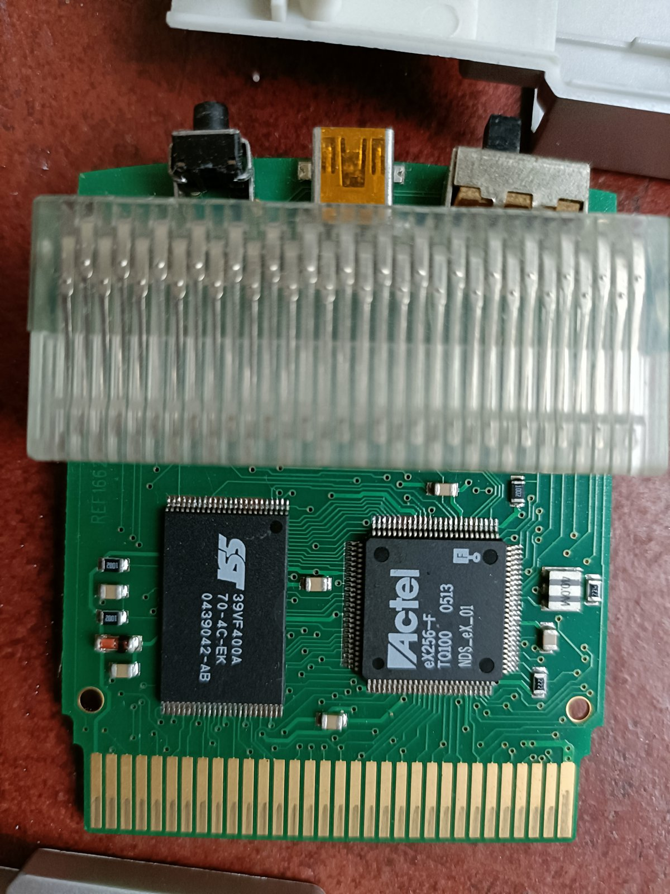
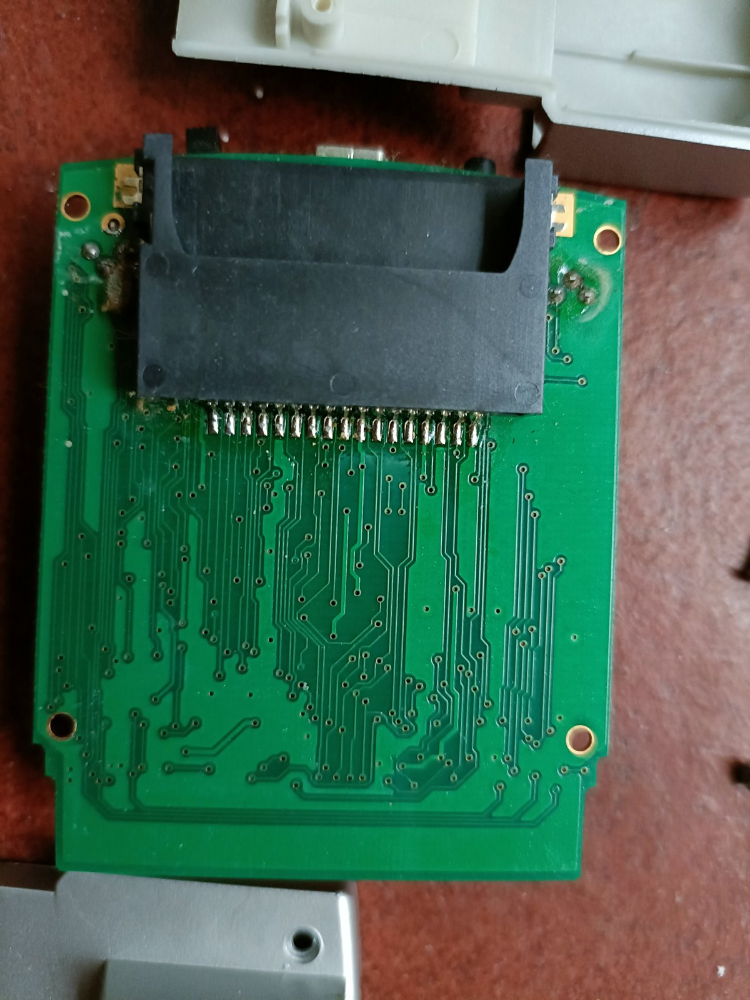
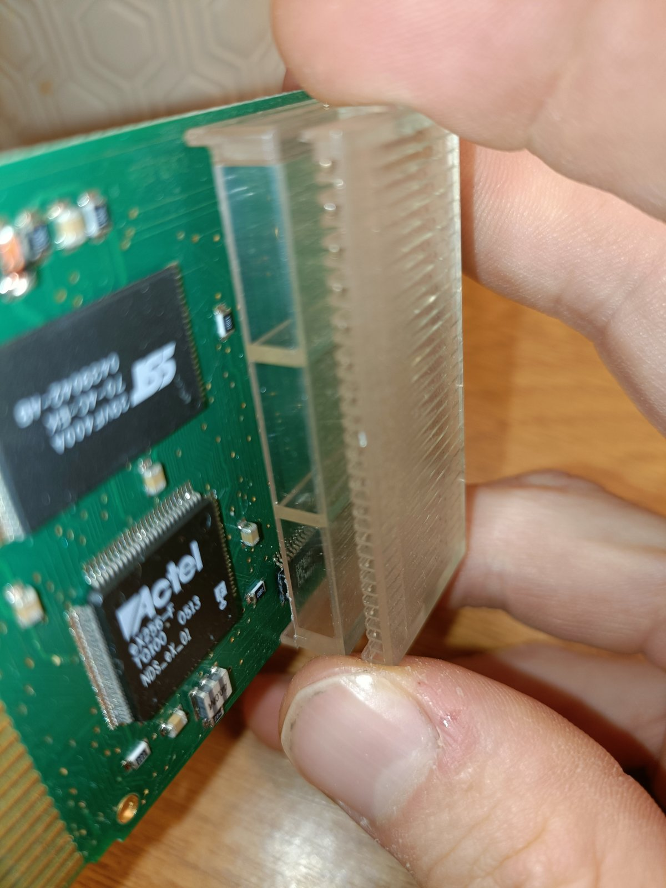

# MAX DUO hardware

As far as we could find, this is the first published teardown of the Action Replay MAX DUO. The board is marked **REF1662**. The chip identities come from photos; the behaviour comes from read-only lab experiments on the same unit ([FINDINGS.md](FINDINGS.md)).

| Front | Back | Under the pass-through slot |
|---|---|---|
|  |  |  |

## The chips

### SST 39VF400A-70-4C-EK: the DUO's flash (date code 0439, late September 2004)
- 4 Mbit = **512 KB**, organised as 256K × 16-bit, with 128 sectors of 4 KB and eight 64 KB blocks. 70 ns access.
- Its part code decodes as: "4" = rated for at least 10,000 erase cycles per sector; "C" = commercial grade; "EK" = 48-pin package.
- Software ID: BF / 2780.
- It holds Datel's program (about 190 KB), the Action Replay code database and Datel's storage area for DS saves. The lab confirmed its size: the flash appears twice below 1 MB in the GBA's address space, with open bus above.

### Actel eX256-F TQ100, marked "NDS_eX_01": the switch (date code 0513, late March 2005)
- An antifuse FPGA, programmed once at the factory and never again. It has 12,000 system gates (about 8,000 typical), 256 registers, 512 logic cells, and up to 81 user pins in the TQ100 package.
- It runs a 2.5 V core with 3.3 V I/O.
- It has **FuseLock** security, so its logic can't be read out. Behavioural experiments are the only way to learn what it does.
- "NDS_eX_01" suggests the design was made for the MAX Drive DS and reused. The date code is only days before the DUO's announcement on 31 March 2005.
- It implements:
  - the mapping register (0x0800009C);
  - the control area at 0x09FE0000–0x09FFFFFF;
  - the swap between the DUO's flash and the game;
  - the overlay on the cartridge header (0x20–0x9F);
  - very likely the "wake" behaviour of the save chip.

### Cypress CY7C63743-QXC: the USB controller (date code 0510, March 2005)
- Cypress "enCoRe" low-speed USB microcontroller: 8-bit CPU, **8 KB one-time-programmable** program memory and 256 bytes of RAM.
- Three USB endpoints, each with an **8-byte buffer**: control, IN 0x81 and OUT 0x02. That's why every DUO message is 8 bytes.
- It has a built-in 6 MHz oscillator, so there's no crystal on the board.
- It needs 4.0–5.5 V, so it runs on the **USB cable's power**. Two things follow from that:
  - It keeps a waiting packet even while the GBA is switched off.
  - Datel's start-up check can find a hello the PC sent before switch-on, and go straight to USB server mode. We use this on purpose (see FINDINGS.md).
- Its program is fixed, so the one-packet-at-a-time rule is permanent: the DUO can't be made to transfer faster, only to send less.
- It sits under the clear pass-through slot, and can only be seen from the side.

### Everything else
- **Top edge:** a tactile button, the mini-USB socket and the slide switch.
- **Clear block:** the pass-through slot for the GBA game. Most of its lines run straight to the edge connector, with the Actel controlling the chip selects.
- **Back:** a 17-contact DS card slot (the MAX Drive DS side), with hand-soldered contacts.
- **Small parts:** passives, an inductor or ferrite (the striped part beside the Actel), and presumably the 2.5 V regulator for the Actel.
- **Care:** there's some flux residue near the DS slot. A gentle clean with isopropyl alcohol is kind to a 20-year-old board.

## How it fits together

```
PC ══ low-speed USB ══ Cypress CY7C63743 (fixed program, 8-byte buffers)
                              ║ 8-bit link + one handshake (strictly one packet each way in turn)
GBA ══ cartridge bus ══ Actel eX256 "NDS_eX_01" (mapping, control registers, header overlay)
                              ├── SST 39VF400A flash, 512 KB (Datel firmware, codes, stored saves)
                              ├── pass-through slot → GBA game (ROM, save chip, RTC)
                              └── DS card slot (MAX Drive DS saves)
```

The GBA does all the computing. At switch-on it runs Datel's program straight from the DUO's flash.

## The GBA's view (memory map)

| Address | What's there |
|---|---|
| 0x08000000–0x0807FFFF | DUO flash (512 KB), mirrored once more up to 1 MB; open bus above |
| 0x08030000–0x0803BFFF | Datel's storage ("DATEL NDS1 V1.0") and directory records |
| 0x08040000–0x0807FFFF | Action Replay code database (256 KB) |
| 0x08000020–0x0800009F | **Overlaid by the Actel in every mode:** reads as zeros, except the mapping register |
| 0x0800009C | Mapping register: 0x0120 = DUO program; 0x0101, 0x0007, 0x0001 = game (these are the values Datel uses) |
| 0x09FE0000–0x09FFFFFF | DUO control area, including the byte-wide link to the USB chip |
| 0x0E000000 | The game's save chip, when the game is mapped (8-bit bus) |

In Datel's firmware: the boot routine is at 0x080073F4; the screen table is at 0x0802AD80 (12-byte entries: enter, update, leave); the go-to-screen routine is at 0x08000E30; and the USB server entry is at 0x08007648. Holding **L** at switch-on selects screen 7 (USB SERVER MODE) in Datel's boot table.

## Related hardware

- The USB ID **05FD:DAAE** is registered to InterAct, which sold Datel's devices as GameShark. The standalone GBA Action Replay / GameShark uses the same ID, the same endpoints and 8-byte packets, so the DUO's USB side was carried over from it.
- The Action Replay DSi is a later design, with SST flash and an FPGA again, but much faster USB.
- Sources: Cypress CY7C637xx datasheet, Microchip/Actel eX family datasheet, and SST 39VF400A datasheet.
